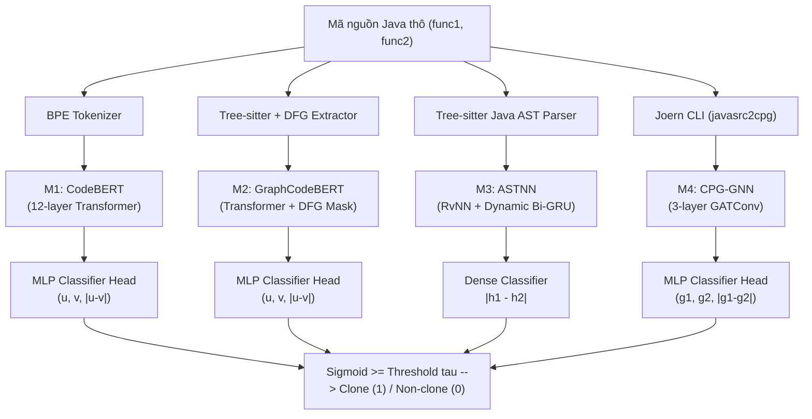

# Hướng dẫn Toàn diện: Cấu hình, Lý thuyết, Luồng xử lý và Kết quả Huấn luyện 4 Phương pháp (BigCloneBench Java)

Tài liệu này cung cấp bản giải thích chi tiết, đầy đủ và súc tích nhất về quy trình huấn luyện, tiền xử lý, cấu trúc mô hình và kết quả thực nghiệm của 4 phương pháp phát hiện bản sao mã nguồn ngữ nghĩa (**M1 CodeBERT**, **M2 GraphCodeBERT**, **M3 ASTNN**, **M4 CPG-GNN**) trên tập dữ liệu chuẩn **BigCloneBench (Java)**.

---

## 1. Tổng quan Bài toán & Tập dữ liệu BigCloneBench

### 1.1. Định nghĩa bài toán
- **Mục tiêu:** Cho trước một cặp hàm mã nguồn Java $(f_1, f_2)$, mô hình cần dự đoán nhãn nhị phân:
  - $y = 1$: **Clone (Trùng lặp)** — Hai hàm tương đồng về cú pháp hoặc ngữ nghĩa chức năng (Type-1 $\to$ Type-4).
  - $y = 0$: **Non-clone (Không trùng lặp)** — Hai hàm thực hiện hai tác vụ hoàn toàn khác nhau.
- **Thách thức cốt lõi:** Phân biệt chính xác **Type-4 Semantic Clones** (khác biệt hoàn toàn về thuật toán, cú pháp nhưng cùng chức năng) và phát hiện các ca **Non-clone cạm bẫy** (chung cấu trúc thư viện/hàm khung nhưng khác nghiệp vụ).

### 1.2. Thống kê phân chia tập dữ liệu
Dự án trích xuất từ benchmark quốc tế **CodeXGLUE** (`google/code_x_glue_cc_clone_detection_big_clone_bench`):

| Tập dữ liệu | Số lượng cặp | Tỉ lệ Clone : Non-clone | Mục đích sử dụng |
| :--- | :---: | :---: | :--- |
| **Train** | 30.000 | 50% : 50% (15.000 : 15.000) | Huấn luyện cập nhật trọng số |
| **Validation** | 3.000 | 50% : 50% (1.500 : 1.500) | Early stopping, tìm ngưỡng $\tau$ tối ưu F1 |
| **Test cân bằng** | 5.000 | 50% : 50% (2.500 : 2.500) | Đánh giá tổng quát trong điều kiện cân bằng |
| **Test phân loại 1:5** | 720 | 1:5 (120 Clone : 600 Non-clone) | Kiểm thử thực tế chống cạm bẫy cú pháp |

---

## 2. Bảng Thông số Cấu hình Huấn luyện (Configs)

```yaml
# Cấu hình chung trên môi trường GPU Kaggle (Tesla T4 / P100)
device: cuda
mixed_precision: fp16 (AMP)
loss_function: BCEWithLogitsLoss
threshold_search: [0.01, 0.99, step=0.01] (tối ưu hóa F1 trên Validation)
```

| Thuộc tính cấu hình | M1 Đóng băng 12 tầng | M1 Fine-tuning toàn bộ | M2 Đóng băng 12 tầng | M2 Fine-tuning toàn bộ | M3 (ASTNN) | M4 (CPG-GNN) |
| :--- | :---: | :---: | :---: | :---: | :---: | :---: |
| **Pre-trained Backbone** | `codebert-base` | `codebert-base` | `graphcodebert-base` | `graphcodebert-base` | Không (huấn luyện từ đầu) | Không (huấn luyện từ đầu) |
| **Số tham số học được** | $1,77\text{ M}$ (chỉ Head) | $126,4\text{ M}$ (Toàn bộ) | $1,77\text{ M}$ (chỉ Head) | $126,4\text{ M}$ (Toàn bộ) | $\approx 2,1\text{ M}$ | $\approx 1,5\text{ M}$ |
| **Biểu diễn đầu vào** | Chuỗi Token ($\le 256$) | Chuỗi Token ($\le 256$) | Token + Data Flow (DFG) | Token + Data Flow (DFG) | Cây cú pháp phân đoạn | Đồ thị CPG (Node + Edge) |
| **Thuật toán tối ưu** | AdamW | AdamW | AdamW | AdamW | Adam | AdamW |
| **Tốc độ học (LR)** | $10^{-3}$ | $2 \times 10^{-5}$ | $10^{-3}$ | $2 \times 10^{-5}$ | $10^{-3}$ | $5 \times 10^{-4}$ |
| **Weight Decay** | $0,01$ | $0,01$ | $0,01$ | $0,01$ | $10^{-4}$ | $10^{-4}$ |
| **Kích thước Batch** | 64 | 64 | 64 | 64 | 32 | 32 |
| **Số Epochs** | 3 | 5 | 3 | 5 | 5 | 5 |
| **Hàm mất mát** | BCEWithLogits | BCEWithLogits | BCEWithLogits | BCEWithLogits | BCEWithLogits | BCEWithLogits |
| **Ngưỡng quyết định ($\tau$)**| $0,46$ | $0,88$ | $0,014$ | $0,94$ | $0,52$ | $0,70$ |

---

## 3. Lý thuyết & Luồng xử lý chi tiết của 4 Phương pháp



---

### 3.1. M1: CodeBERT (Sequence Transformer)
- **Lý thuyết:** Kiến trúc đa tầng Transformer Encoder (12 layers, 12 attention heads, 768 hidden dimension) tiền huấn luyện trên 6 ngôn ngữ lập trình bằng hai tác vụ: Masked Language Modeling (MLM) và Bimodal Dual Learning.
- **Đầu vào:** Cặp chuỗi mã nguồn thô Java `(func1, func2)`.
- **Tiền xử lý:**
  1. Chuẩn hóa ký tự xuống dòng `\r\n` $\to$ `\n`, loại bỏ khoảng trắng thừa.
  2. Byte-Pair Encoding (BPE) tokenizer mã hóa văn bản thành chuỗi subword ID.
  3. Đóng gói cặp chuỗi: `[CLS] func1 [SEP] func2 [SEP]`. Giới hạn độ dài $\le 256$ token.
- **Luồng xử lý (Flow):**
  1. Đưa tensor token qua 12 tầng Transformer Encoder để thu được contextual representation cho từng token.
  2. Trích xuất vector đại diện `[CLS]` ($h_{\text{CLS}} \in \mathbb{R}^{768}$) hoặc vector embedding trung bình của từng hàm ($u, v \in \mathbb{R}^{768}$).
  3. Xây dựng vector tương quan: $x_{\text{pair}} = [u \,\|\, v \,\|\, |u - v|] \in \mathbb{R}^{2304}$.
  4. Đưa qua tầng phân loại MLP ($2304 \to 256 \to 1$).
- **Đầu ra:** Logit $z \in \mathbb{R} \to$ Xác suất $\hat{p} = \sigma(z) \in [0, 1]$. Nếu $\hat{p} \ge \tau$ thì kết luận là **Clone**, ngược lại là **Non-clone**.

---

### 3.2. M2: GraphCodeBERT (Transformer + Luồng dữ liệu DFG)
- **Lý thuyết:** Khắc phục nhược điểm của CodeBERT (chỉ nhìn code như văn bản tự nhiên không có ngữ nghĩa chương trình) bằng cách bổ sung đồ thị luồng dữ liệu (**Data Flow Graph - DFG**). DFG biểu diễn các chuỗi định nghĩa - sử dụng (def-use chains) của biến, giúp nhận diện code tương đương ngay cả khi đổi thứ tự câu lệnh hoặc đổi tên biến.
- **Đầu vào:** Cặp mã nguồn Java `(func1, func2)`.
- **Tiền xử lý:**
  1. Sử dụng parser `tree-sitter-java` quét cây AST để trích xuất các biến và các cạnh phụ thuộc dữ liệu (biến A lấy giá trị từ biến B).
  2. Token hóa mã nguồn thành chuỗi token.
  3. Ghép nối chuỗi đầu vào hỗn hợp:
     $$\text{Input} = [\text{CLS}] + \text{Tokens}_1 + [\text{SEP}] + \text{Tokens}_2 + [\text{SEP}] + \text{DFG}_1 + \text{DFG}_2$$
  4. Tạo ma trận **Graph-Guided Attention Mask**: chỉ cho phép các token biến trong DFG tương tác với các token mã nguồn liên quan trực tiếp đến luồng dữ liệu của nó.
- **Luồng xử lý (Flow):**
  1. 12 tầng Transformer tự động điều hòa thông tin giữa cú pháp chuỗi và đồ thị luồng dữ liệu thông qua ma trận mask.
  2. Trích xuất vector đại diện toàn cục của cặp hàm.
  3. Đưa qua tầng MLP Classifier Head ($2304 \to 256 \to 1$).
- **Đầu ra:** Xác suất $\hat{p} \in [0, 1] \to$ So sánh với ngưỡng $\tau = 0,94$ (hoặc $\tau = 0,014$ ở bản Đóng băng).

---

### 3.3. M3: ASTNN (Cây cú pháp phân đoạn câu lệnh — RvNN + Bi-GRU)
- **Lý thuyết:** Cây cú pháp toàn phần (Complete AST) của Java thường quá sâu (hơn 50 tầng) khiến mạng nơ-ron cây truyền thống bị bùng nổ gradient hoặc tiêu biến thông tin. ASTNN giải quyết bằng cách:
  - Cắt cây AST thành **chuỗi các cây con cấp câu lệnh** (Statement-level Subtrees).
  - Dùng **RvNN (Recursive Neural Network)** mã hóa từng cây con câu lệnh thành một vector.
  - Dùng **Bi-GRU (Bidirectional GRU)** để bắt ngữ cảnh tuần tự giữa các câu lệnh.
- **Đầu vào:** Mã nguồn Java của hàm.
- **Tiền xử lý:**
  1. Phân tích cú pháp bằng `tree-sitter-java`.
  2. Duyệt cây và gom các nút theo từng câu lệnh Java (`method_declaration`, `for_statement`, `while_statement`, `if_statement`, `try_catch`,...); cắt tỉa các nút con không bản chất.
  3. Trừu tượng hóa lá (Statement Abstraction): đổi tất cả tên biến/hàm thành token chuẩn `ID`, số thành `NUM`, chuỗi thành `STR`.
  4. Đóng gói cây phân cấp vào bộ nhớ cache nén `bcb_ast_cache.npz`.
- **Luồng xử lý (Flow):**
  1. Mỗi cây con câu lệnh được tính vector biểu diễn bằng mạng đệ quy:
     $$e_{\text{stmt}} = \tanh\left(W \cdot e_{\text{root}} + \sum \frac{W_i \cdot e_{\text{child}_i}}{N}\right)$$
  2. Chuỗi vector câu lệnh $(e_1, e_2, \dots, e_T)$ được đưa qua tầng Bi-GRU (hidden size 100).
  3. Áp dụng Max-pooling dọc theo trục thời gian để thu được vector biểu diễn hàm $h \in \mathbb{R}^{100}$.
  4. Tính khoảng cách tuyệt đối giữa 2 hàm: $v_{\text{diff}} = |h_1 - h_2| \in \mathbb{R}^{100}$.
  5. Đưa qua tầng Dense + Sigmoid để ra xác suất clone.
- **Đầu ra:** Điểm tương đồng $\hat{p} \in [0, 1] \to$ So sánh với ngưỡng $\tau = 0,52$.

---

### 3.4. M4: CPG-GNN (Đồ thị thuộc tính mã nguồn — Joern + GAT)
- **Lý thuyết:** Code Property Graph (CPG) là đồ thị đa quan hệ kết hợp cả:
  - Cây cú pháp trừu tượng (**AST** — Quan hệ cấu trúc ngữ pháp).
  - Đồ thị luồng điều khiển (**CFG** — Thứ tự thực thi câu lệnh, rẽ nhánh).
  - Đồ thị phụ thuộc dữ liệu (**DDG** — Luồng biến và giá trị).
  Mạng **GAT (Graph Attention Network)** tự động học mức độ quan trọng của các đỉnh lân cận qua cơ chế chú ý (attention weights trên cạnh).
- **Đầu vào:** Mã nguồn Java của hàm.
- **Tiền xử lý:**
  1. Sử dụng công cụ mã nguồn mở **Joern CLI** (`javasrc2cpg`) biên dịch mã Java thành đồ thị CPG đa cạnh.
  2. Trích xuất thuộc tính từng đỉnh: Loại đỉnh (`METHOD`, `CALL`, `IDENTIFIER`, `BLOCK`, `LITERAL`) và nhãn mã (`code`).
  3. Trích xuất tensor cạnh `edge_index` (kích thước $[2, E]$) và loại cạnh `edge_type`.
  4. Tạo đối tượng `torch_geometric.data.Data` và đóng gói nén `bcb_cpg_export.tar.gz`.
- **Luồng xử lý (Flow):**
  1. Vector hóa đặc trưng nút qua tầng nhúng `Embedding` (chiều 128).
  2. Đưa qua 3 tầng tích chập đồ thị `GATConv` (với $K=4$ attention heads):
     $$h_i^{(l+1)} = \sigma\left(\sum_{j \in \mathcal{N}(i)} \alpha_{ij}^{(l)} W^{(l)} h_j^{(l)}\right)$$
  3. Tổng hợp vector toàn đồ thị (Graph Readout) qua `global_mean_pool` và `global_max_pool` $\to g \in \mathbb{R}^{128}$.
  4. Ghép vector cặp đồ thị: $x_{\text{cpg}} = [g_1 \,\|\, g_2 \,\|\, |g_1 - g_2|] \in \mathbb{R}^{384}$.
  5. Đưa qua MLP Classifier Head ($384 \to 64 \to 1$).
- **Đầu ra:** Điểm tương đồng $\hat{p} \in [0, 1] \to$ So sánh với ngưỡng $\tau = 0,70$.

---

## 4. Bảng Kết quả Thực nghiệm & Phân tích Đột phá

### 4.1. Kết quả kiểm thử đối chứng trên tập Java (720 cặp — Tỉ lệ 1:5)

| Mô hình / Phiên bản | Ngưỡng $\tau$ | Đúng Trùng lặp (TP/120) | Đúng Không TL (TN/600) | F1-Score | Precision | Recall | Accuracy |
| :--- | :---: | :---: | :---: | :---: | :---: | :---: | :---: |
| **M1 Chưa huấn luyện** | 0,99 | 117 / 120 | 35 / 600 | 29,18% | 17,16% | 97,50% | 21,11% |
| **M1 Đóng băng 12 tầng** | 0,46 | 70 / 120 | 532 / 600 | **54,26%** | **50,72%** | 58,33% | **83,61%** |
| **M1 Fine-tuning toàn bộ** | 0,88 | 118 / 120 | 142 / 600 | 33,91% | 20,49% | **98,33%** | 36,11% |
| **M2 Chưa huấn luyện** | 0,97 | 74 / 120 | 571 / 600 | **66,37%** | **71,84%** | 61,67% | **89,58%** |
| **M2 Đóng băng 12 tầng** | 0,014 | 74 / 120 | 532 / 600 | 56,49% | 52,11% | 61,67% | 84,17% |
| **M2 Fine-tuning toàn bộ** | 0,94 | 114 / 120 | 465 / 600 | 61,79% | 45,78% | **95,00%** | 80,42% |
| **M3 Chưa huấn luyện** | 0,91 | 120 / 120 | 109 / 600 | **32,83%** | **19,64%** | **100,00%** | 31,81% |
| **M3 Fine-tuning toàn bộ** | 0,52 | 92 / 120 | 190 / 600 | 29,58% | 18,33% | 76,67% | **39,17%** |
| **M4 Chưa huấn luyện** | 0,10 | 120 / 120 | 0 / 600 | **28,57%** | **16,67%** | **100,00%** | 16,67% |
| **M4 Fine-tuning toàn bộ** | 0,70 | 0 / 120 | 600 / 600 | 0,00% | 0,00% | 0,00% | **83,33%** |

---

### 4.2. Giải thích cơ chế biến đổi kết quả qua từng bước

1. **Từ "Chưa huấn luyện" sang "Fine-tuning toàn bộ":**
   - *Hiện tượng:* Recall đạt đỉnh tuyệt đối (95% – 98% clone được bắt trọn), bắt rất mạnh các ca Type-4 khác thuật toán.
   - *Mặt trái:* Do tập train cân bằng 50:50, khi đưa vào môi trường kiểm thử thực tế bị mất cân bằng 1:5, mô hình bị thiên lệch dự đoán nhãn 1 (bias toward clone), gây bùng nổ **báo động giả (False Positives)** trên các ca non-clone cạm bẫy (chỉ đoán đúng 142/600 ở M1).
2. **Từ "Fine-tuning toàn bộ" sang "Đóng băng 12 tầng (Freeze Backbone)":**
   - *Hiện tượng:* Khả năng nhận diện Non-clone nhảy vọt (từ 142 lên **532 / 600** ở M1), giảm số ca báo động giả từ 458 xuống còn 68 ca; Accuracy tăng vọt từ 36,11% lên **83,61%**; F1 tăng từ 33,91% lên **54,26%**.
   - *Cơ chế:* Đóng băng 12 tầng Transformer giúp giữ nguyên $100\%$ không gian vector tiền huấn luyện đa ngữ gốc của Microsoft, tránh hiện tượng "quên tri thức ban đầu" (Catastrophic Forgetting). Chỉ học 1,77M tham số ở MLP Head giúp mô hình thiết lập ranh giới quyết định chặt chẽ hơn, không bị overfit theo nhãn clone.
3. **Vì sao GraphCodeBERT (M2) vượt trội CodeBERT (M1):**
   - Đồ thị luồng dữ liệu (DFG) giúp M2 hiểu được bản chất luồng truyền biến. Nhờ đó, M2 phân biệt được các đoạn mã dù có cùng tên biến nhưng khác luồng logic, giúp M2 Fine-tuning giữ được **465 / 600** non-clone (vượt xa mức 142/600 của M1) và đạt F1 **61,79%**.
4. **Vì sao ASTNN (M3) và CPG-GNN (M4) bị nghẽn hiệu năng:**
   - *M3 (ASTNN):* Các hàm Java thực tế có cấu trúc lồng nhau phức tạp (try-with-resources, anonymous class). Khi đưa qua chuỗi câu lệnh dài, mạng RvNN + Bi-GRU bị phân tán và mất liên kết dài hạn giữa câu lệnh đầu và cuối hàm.
   - *M4 (CPG-GNN):* Đồ thị CPG do Joern sinh ra chứa hàng nghìn đỉnh và cạnh nhiễu (nhiều nút trung gian AST không mang ngữ nghĩa quyết định). GAT 3 tầng chưa đủ sâu để nén đồ thị lớn nếu không có kỹ thuật trích xuất lát cắt chương trình (Program Slicing).

---

## 5. Tóm tắt Định hướng Tối ưu Tiếp theo

1. **Áp dụng LoRA / PEFT (Ưu tiên số 1):** Kết hợp trọn vẹn điểm mạnh của Đóng băng (giữ 532/600 non-clone) và Fine-tuning (bắt 95% Type-4 clone) bằng cách chèn ma trận rank thấp $r=8$ vào module Attention của GraphCodeBERT.
2. **Hard Negative Mining & Focal Loss:** Bổ sung các cặp non-clone cạm bẫy vào tập huấn luyện và áp dụng Focal Loss phạt nặng các ca đoán sai non-clone.
3. **Cắt tỉa biểu diễn (AST Pruning & Program Slicing):** Rút gọn cây AST cho M3 và chỉ giữ lại lát cắt phụ thuộc biến chính trong CPG cho M4.
