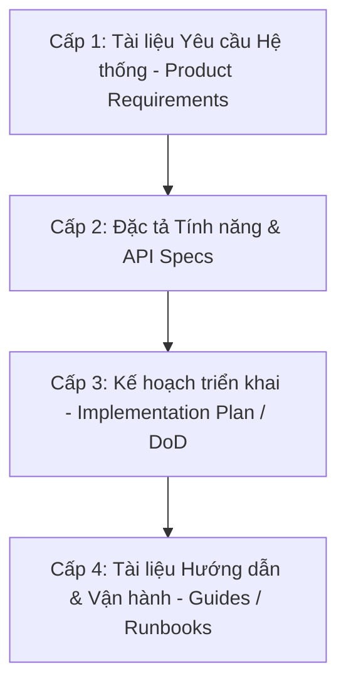

# Quy chế Quản lý Tài liệu (document_management_policy.md)

| Mục | Nội dung |
| :--- | :--- |
| **Phiên bản** | 1.1.0 |
| **Ngày cập nhật** | 2026-08-07 |
| **Tác giả** | Phát triển Hệ thống |
| **Trạng thái** | Xác nhận |

---

## 1. Định dạng Tài liệu Bắt buộc (Markdown Format)

Mọi tài liệu Markdown (`.md`) được tạo mới hoặc cập nhật trong phạm vi dự án bắt buộc phải tuân thủ cấu trúc chuẩn hóa dưới đây. AI và lập trình viên phải đảm bảo không bỏ sót bất kỳ phần nào.

### 1.1 Bảng Thông tin Quản lý Tài liệu (冒頭ヘッダー)
Đặt ngay bên dưới tiêu đề chính (`# tiêu đề`). Bảng phải chứa tối thiểu 4 thông tin sau:

| Trường | Mô tả | Định dạng |
| :--- | :--- | :--- |
| **Phiên bản** | Phiên bản hiện tại của tài liệu | Định dạng Semantic Versioning `X.Y.Z` |
| **Ngày cập nhật** | Ngày thực hiện thay đổi gần nhất | Định dạng ISO `YYYY-MM-DD` |
| **Tác giả** | Người tạo hoặc người cập nhật chính | Tên hoặc Github ID |
| **Trạng thái** | Tình trạng hiện tại của tài liệu | `Draft` (Nháp) / `Reviewing` (Đang duyệt) / `Approved` (Xác nhận) |

*Lưu ý: Có thể thêm các dòng bổ sung tùy chọn như "Mã API", "Hệ thống liên quan" phía sau các dòng bắt buộc.*

### 1.2 Mục lục (Table of Contents)
- Bắt buộc phải có phần `## Mục lục` đặt ngay sau bảng quản lý tài liệu.
- Tất cả các đề mục chính (`##`, `###`) phải được liệt kê dưới dạng các liên kết anchor nội bộ (ví dụ: `[1. ĐỊNH DẠNG TÀI LIỆU BẮT BUỘC](#1-dinh-dang-tai-lieu-bat-buoc)`).
- Ở cuối mỗi đề mục lớn, nên có liên kết để quay lại mục lục: `[🔝 Quay lại mục lục](#top)` (tương ứng với thẻ `` ở đầu tài liệu).

### 1.3 Lịch sử Thay đổi (Changelog / Revision History)
- Bắt buộc phải có phần `## Lịch sử thay đổi` đặt ở cuối cùng của tài liệu.
- Dưới dạng bảng có các cột: `No.`, `Phiên bản`, `Ngày thay đổi`, `Nội dung thay đổi`.
- Mọi chỉnh sửa nội dung logic của tài liệu (không tính sửa lỗi chính tả) đều phải được tăng phiên bản và ghi nhận một dòng mới vào bảng này.

### 1.4 Quy định Đặc tả API (REST / Realtime)
- Mỗi API (REST hoặc Realtime) bắt buộc phải được viết trong một tệp `.md` riêng biệt.
- Cấu trúc thư mục và quy tắc đặt tên tệp tin:
  - **REST API:** `docs/specs/api/rest/{name}/{name}_{00x}.md` (ví dụ: `docs/specs/api/rest/sync/sync_001.md`)
  - **Realtime API:** `docs/specs/api/realtime/{name}/{name}_{00x}.md` (ví dụ: `docs/specs/api/realtime/notification/notification_001.md`)
  - Trong đó: `{name}` là tên nhóm API/Module viết thường (ví dụ: `sync`, `wallet`, `transaction`), `{name}_{00x}` gồm tên nhóm và số thứ tự API dạng 3 chữ số bắt đầu bằng `001`.
- Định dạng nội dung: Phải dựa theo đúng cấu trúc của `api_template.md` (đối với REST API) hoặc `realtime_template.md` (đối với Realtime API).

---

## 2. Quy tắc Đánh số Phiên bản (Versioning Rules)

Áp dụng quy tắc Semantic Versioning (`X.Y.Z`) cho tài liệu dựa trên mức độ thay đổi nội dung:

### Phiên bản lớn - Major Update (X.0.0)
- **Khi nào**: Có thay đổi cấu trúc nghiêm trọng, đổi mới toàn bộ quy chuẩn hoặc thay đổi logic không tương thích ngược (ví dụ: Thiết kế lại toàn bộ luồng nghiệp vụ API).
- **Hành động**: Tăng chữ số `X` (ví dụ: `1.4.2` -> `2.0.0`).

### Phiên bản nhỏ - Minor Update (x.X.0)
- **Khi nào**: Thêm các tính năng mới, thêm API mới, bổ sung các mô tả chi tiết, hoặc tích hợp các phần bổ trợ mà không làm thay đổi các quy tắc cũ.
- **Hành động**: Tăng chữ số `Y` và reset `Z` về 0 (ví dụ: `1.4.2` -> `1.5.0`).

### Phiên bản sửa lỗi - Patch Update (x.y.X)
- **Khi nào**: Chỉnh sửa lỗi chính tả, làm rõ câu chữ, cập nhật lại các link bị hỏng hoặc các định dạng hiển thị nhỏ.
- **Hành động**: Tăng chữ số `Z` (ví dụ: `1.4.2` -> `1.4.3`).

---

## 3. Phân cấp Tài liệu & Thứ tự Ưu tiên

Khi có sự mâu thuẫn thông tin giữa các tài liệu khác nhau, thứ tự ưu tiên áp dụng để làm chuẩn (Source of Truth) sẽ tuân theo cấp bậc từ cao xuống thấp như sau:

1. **Cấp 1: Tài liệu Yêu cầu Hệ thống (`docs/specs/system/requirements.md` hoặc tương đương)**: Là tiêu chuẩn cao nhất về mặt nghiệp vụ. Không được sửa đổi trừ khi có sự đồng ý rõ ràng của chủ sở hữu sản phẩm (PO).
2. **Cấp 2: Đặc tả Tính năng & Thiết kế chi tiết (`docs/specs/features/`, `docs/specs/architecture/`, `docs/specs/api/`)**: Đặc tả giao diện UI/UX và thiết kế chi tiết hệ thống.
3. **Cấp 3: Kế hoạch triển khai & Definition of Done (`*_implementation_plan.md` ở thư mục brain)**: Các mốc công việc và trạng thái hoàn thành cụ thể.
4. **Cấp 4: Hướng dẫn nghiệp vụ & Cấu hình (`docs/guides/*`, `README.md`)**: Hướng dẫn cài đặt môi trường, vận hành công cụ.

*Nguyên tắc xử lý mâu thuẫn: Tài liệu cấp cao hơn luôn luôn phủ quyết tài liệu cấp thấp hơn.*

---

## 4. Nhật ký Thay đổi

| No. | Phiên bản | Ngày thay đổi | Nội dung thay đổi |
| :--- | :--- | :--- | :--- |
| 1 | 1.0.0 | 2026-08-07 | Khởi tạo tài liệu quy chế quản lý tài liệu dự án tiếng Việt chuẩn hóa. |
| 2 | 1.0.1 | 2026-08-07 | Cập nhật đường dẫn tham chiếu đến tài liệu yêu cầu hệ thống và đặc tả chi tiết. |
| 3 | 1.1.0 | 2026-08-07 | Bổ sung quy định bắt buộc phân rã tài liệu API thành từng tệp riêng biệt theo định dạng nhóm. |
