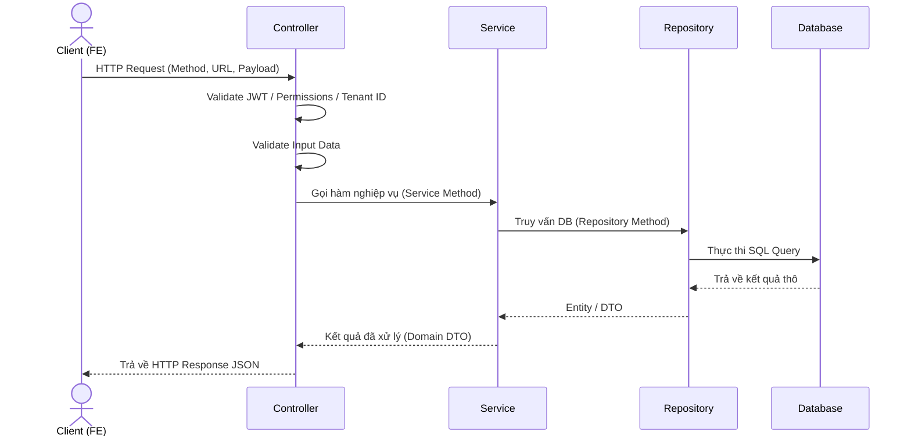

<a id="top"></a>

# Thiết kế Chi tiết REST API (api_template.md)

| Mục | Nội dung |
| :--- | :--- |
| **Phiên bản** | 1.0.0 |
| **Ngày cập nhật** | [YYYY-MM-DD] |
| **Tác giả** | [Tên tác giả] |
| **Trạng thái** | Draft / Reviewing / Approved |
| **Mã API** | [Ví dụ: API_USER_0010] |

---

## Mục lục

- [1. Thông tin Quản lý Tài liệu](#1-thong-tin-quan-ly-tai-lieu)
- [2. Tổng quan](#2-tong-quan)
- [3. Tham số đầu vào (Parameters)](#3-tham-so-dau-vao-parameters)
- [4. Sơ đồ tuần tự (Sequence Diagram)](#4-so-do-tuan-tu-sequence-diagram)
- [5. Xử lý chi tiết (Detailed Logic)](#5-xu-ly-chi-tiet-detailed-logic)
- [6. Phản hồi thành công (Success Response)](#6-phan-hoi-thanh-cong-success-response)
- [7. Phản hồi lỗi (Error Response)](#7-phan-hoi-loi-error-response)
- [8. Xử lý kiểm tra logic (Business Validation)](#8-xu-ly-kiem-tra-logic-business-validation)
- [9. SQL / JPA Query](#9-sql--jpa-query)
- [10. Tài liệu tham khảo](#10-tai-lieu-tham-khao)
- [11. Lịch sử thay đổi](#11-lich-su-thay-doi)

---

## 1. Thông tin Quản lý Tài liệu

Tài liệu này định nghĩa chi tiết cấu trúc REST API cho tính năng `[Tên tính năng]`. Mọi thay đổi về endpoint hoặc payload phải được phản ánh vào tài liệu này và tăng phiên bản tương ứng.

[🔝 Quay lại mục lục](#top)

---

## 2. Tổng quan

*[Mô tả ngắn gọn về chức năng của API này. Ví dụ: Lấy danh sách người dùng có phân trang.]*

| Trường | Nội dung |
| :--- | :--- |
| **Endpoint** | `[Ví dụ: /api/v1/users]` |
| **Method** | `[GET / POST / PUT / DELETE]` |
| **Content-Type** | `application/json` |
| **Xác thực (Authorization)** | `Bearer <accessToken>` / Không yêu cầu |
| **Yêu cầu Tenant** | Có (yêu cầu header `X-Tenant-ID`) / Không |

[🔝 Quay lại mục lục](#top)

---

## 3. Tham số đầu vào (Parameters)

### 3.1 Path Parameters
*[Nếu có path parameters, điền vào đây. Nếu không ghi "Không có"]*

### 3.2 Query Parameters / Request Body
*[Định nghĩa các tham số truyền lên qua URL Query hoặc Body JSON]*

| # | Trường | Kiểu | Bắt buộc | Mô tả / Ràng buộc |
| :--- | :--- | :--- | :--- | :--- |
| 1 | `page` | number | Không | Số trang hiện tại (mặc định là 1) |
| 2 | `pageSize` | number | Không | Số lượng bản ghi trên một trang (mặc định 20, max 100) |
| 3 | `keyword` | string | Không | Từ khóa tìm kiếm theo tên hoặc email |

[🔝 Quay lại mục lục](#top)

---

## 4. Sơ đồ tuần tự (Sequence Diagram)



[🔝 Quay lại mục lục](#top)

---

## 5. Xử lý chi tiết (Detailed Logic)

### 5.1 Middleware / Filters
- **Xác thực**: Xác định thông tin User từ token JWT gửi kèm trong header `Authorization`.
- **Phân quyền**: User phải có quyền `[TÊN_QUYỀN]` hoặc role `[TÊN_ROLE]` để truy cập.
- **Tenant ID**: Phục hồi `tenant_id` từ header `X-Tenant-ID` để lọc dữ liệu.

### 5.2 Kiểm tra dữ liệu (Validation)
- Kiểm tra tính hợp lệ của tham số truyền vào (định dạng email, độ dài chuỗi, khoảng giá trị,...).

### 5.3 Logic tại Controller
- File code tương ứng: `[Đường dẫn file Controller, ví dụ: backend-spring/src/.../UserController.java]`
- Nhiệm vụ: Tiếp nhận request, chuyển đổi sang Request DTO, gọi sang Service, trả về Response theo chuẩn.

### 5.4 Logic tại Service
- File code tương ứng: `[Đường dẫn file Service, ví dụ: backend-spring/src/.../UserService.java]`
- Nhiệm vụ: Xử lý nghiệp vụ chính, ghi log, quản lý Transaction (`@Transactional`).

### 5.5 Logic tại DTO Mapping
- Chuyển đổi dữ liệu từ Entity Database sang DTO Response để bảo mật các trường nhạy cảm.

[🔝 Quay lại mục lục](#top)

---

## 6. Phản hồi thành công (Success Response)

Phản hồi thành công phải tuân thủ cấu trúc envelope `{ data, meta }`.

**Cấu trúc dữ liệu trả về:**

| # | Trường | Kiểu | Mô tả |
| :--- | :--- | :--- | :--- |
| 1 | `data` | array / object | Chứa thông tin nghiệp vụ |
| 2 | `meta.pagination.page` | number | Số trang hiện tại |
| 3 | `meta.pagination.pageSize` | number | Số lượng bản ghi trên một trang |
| 4 | `meta.pagination.total` | number | Tổng số bản ghi |
| 5 | `meta.pagination.hasMore` | boolean | Còn trang tiếp theo hay không |

**Ví dụ JSON Response:**
```json
{
  "data": [
    {
      "id": "123e4567-e89b-12d3-a456-426614174000",
      "name": "Nguyen Van A",
      "email": "a.nguyen@example.com"
    }
  ],
  "meta": {
    "traceId": "req-987654321",
    "timestamp": "2026-08-07T14:00:00Z",
    "pagination": {
      "page": 1,
      "pageSize": 20,
      "total": 1,
      "hasMore": false
    }
  }
}
```

[🔝 Quay lại mục lục](#top)

---

## 7. Phản hồi lỗi (Error Response)

Khi xảy ra lỗi, API trả về mã lỗi HTTP tương ứng và body dạng `{ error, meta }`.

| HTTP Status | Error Code | i18n Key | Điều kiện xảy ra |
| :--- | :--- | :--- | :--- |
| 400 | `VALIDATION` | `error.validation.invalidInput` | Tham số truyền lên không đúng định dạng |
| 401 | `UNAUTHORIZED` | `error.auth.unauthorized` | Token hết hạn hoặc không hợp lệ |
| 403 | `FORBIDDEN` | `error.auth.forbidden` | User không có quyền truy cập |
| 404 | `NOT_FOUND` | `error.common.notFound` | Bản ghi yêu cầu không tồn tại |

**Ví dụ JSON Response Lỗi:**
```json
{
  "error": {
    "code": "VALIDATION",
    "errors": [
      {
        "field": "email",
        "code": "INVALID_FORMAT"
      }
    ]
  },
  "meta": {
    "traceId": "req-987654321",
    "timestamp": "2026-08-07T14:00:00Z"
  }
}
```

[🔝 Quay lại mục lục](#top)

---

## 8. Xử lý kiểm tra logic (Business Validation)

*[Mô tả các quy tắc kiểm tra logic nghiệp vụ sâu trong Database. Ví dụ: Không cho phép tạo User mới nếu email đã tồn tại trong bảng `users`.]*

[🔝 Quay lại mục lục](#top)

---

## 9. SQL / JPA Query

Mô tả các câu lệnh SQL hoặc JPQL được sử dụng trong Repository để truy vấn dữ liệu.

```sql
SELECT u.id, u.name, u.email
FROM users u
WHERE u.tenant_id = :tenantId
  AND (:keyword IS NULL OR u.name ILIKE '%' || :keyword || '%')
ORDER BY u.created_at DESC
LIMIT :limit OFFSET :offset;
```

*   **Các tham số bind**: `:tenantId`, `:keyword`, `:limit`, `:offset`
*   **Chi tiết giao dịch (Transaction)**: `@Transactional(readOnly = true)`

[🔝 Quay lại mục lục](#top)

---

## 10. Tài liệu tham khảo

- [Mẫu thiết kế chung REST API](../specs/system/document_management_policy.md)
- [Đặc tả database_design.md]

[🔝 Quay lại mục lục](#top)

---

## 11. Lịch sử thay đổi

| No. | Phiên bản | Ngày thay đổi | Nội dung thay đổi |
| :--- | :--- | :--- | :--- |
| 1 | 1.0.0 | [YYYY-MM-DD] | Khởi tạo tài liệu thiết kế API. |
