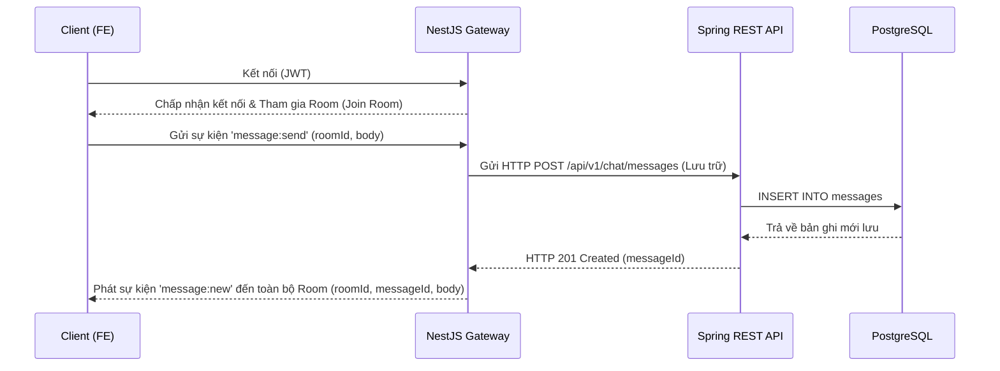

<a id="top"></a>

# Thiết kế Chi tiết Realtime API (realtime_template.md)

| Mục | Nội dung |
| :--- | :--- |
| **Phiên bản** | 1.0.0 |
| **Ngày cập nhật** | [YYYY-MM-DD] |
| **Tác giả** | [Tên tác giả] |
| **Trạng thái** | Draft / Reviewing / Approved |

---

## Mục lục

- [1. Thông tin Quản lý Tài liệu](#1-thong-tin-quan-ly-tai-lieu)
- [2. Tổng quan](#2-tong-quan)
- [3. Kết nối & Xác thực (Connection & Auth)](#3-ket-noi--xac-thuc-connection--auth)
- [4. Định nghĩa Sự kiện (Event List)](#4-dinh-nghia-su-kien-event-list)
- [5. Định nghĩa cấu trúc dữ liệu (Payload Design)](#5-dinh-nghia-cau-truc-du-lieu-payload-design)
- [6. Sơ đồ tuần tự (Sequence Diagram)](#6-so-do-tuan-tu-sequence-diagram)
- [7. Xử lý lỗi, Kết nối lại & Mở rộng (Errors & Scaling)](#7-xu-ly-loi-ket-noi-lai--mo-rong-errors--scaling)
- [8. Tài liệu tham khảo](#8-tai-lieu-tham-khao)
- [9. Lịch sử thay đổi](#9-lich-su-thay-doi)

---

## 1. Thông tin Quản lý Tài liệu

Tài liệu này quy định các sự kiện truyền thông điệp thời gian thực (Realtime WebSockets/Socket.io) cho module `[Tên module, ví dụ: Chat / Presence / Notification]`.

[🔝 Quay lại mục lục](#top)

---

## 2. Tổng quan

*[Mô tả trách nhiệm của WebSocket Server này. Ví dụ: NestJS WebSocket Gateway đảm nhiệm việc truyền tin thời gian thực giữa các User trong cùng một Tenant. Dữ liệu tin nhắn sẽ được lưu trữ đồng bộ qua Spring API trước khi gửi đi.]*

| Trường | Nội dung |
| :--- | :--- |
| **Phạm vi** | `NestJS (backend-nest/src/.../gateway.ts)` |
| **Nền tảng** | `Socket.io` / `WebSockets` / `LiveKit` |

[🔝 Quay lại mục lục](#top)

---

## 3. Kết nối & Xác thực (Connection & Auth)

| Trường | Nội dung |
| :--- | :--- |
| **Namespace / Path** | `[Ví dụ: /socket.io, namespace: /chat]` |
| **Cơ chế xác thực** | `[Ví dụ: Xác thực bằng JWT qua handshake query/auth header]` |
| **Cách phân tách Tenant** | `[Ví dụ: Dựa trên tenant_id giải mã từ JWT để gán vào các Socket Room riêng biệt]` |
| **Thiết kế Room (Phòng)** | `[Ví dụ: tenant:<tenant_id>:chat:<room_id>]` |

[🔝 Quay lại mục lục](#top)

---

## 4. Định nghĩa Sự kiện (Event List)

| # | Tên sự kiện (Event) | Hướng | Điều kiện kích hoạt (Trigger) | Mô tả chi tiết |
| :--- | :--- | :--- | :--- | :--- |
| 1 | `message:send` | Client -> Server | Khi User nhấn gửi tin nhắn | Gửi nội dung tin nhắn mới lên Server để lưu trữ và phát đi |
| 2 | `message:new` | Server -> Client | Khi có tin nhắn mới từ phòng | Server phát đi tin nhắn mới tới toàn bộ Client trong room |
| 3 | `presence:update` | Server -> Client | Khi trạng thái online/offline thay đổi | Phát tín hiệu trạng thái của User tới đồng nghiệp |

[🔝 Quay lại mục lục](#top)

---

## 5. Định nghĩa cấu trúc dữ liệu (Payload Design)

### 5.1 Sự kiện: `message:send` (Client -> Server)
```json
{
  "roomId": "uuid-cua-phong-chat",
  "body": "Noi dung tin nhan",
  "clientMessageId": "uuid-client-tu-tao-de-tranh-trung"
}
```

### 5.2 Sự kiện: `message:new` (Server -> Client)
```json
{
  "messageId": "uuid-tin-nhan-da-luu-db",
  "roomId": "uuid-cua-phong-chat",
  "senderId": "uuid-nguoi-gui",
  "body": "Noi dung tin nhan",
  "createdAt": "2026-08-07T14:00:00Z"
}
```

[🔝 Quay lại mục lục](#top)

---

## 6. Sơ đồ tuần tự (Sequence Diagram)



[🔝 Quay lại mục lục](#top)

---

## 7. Xử lý lỗi, Kết nối lại & Mở rộng (Errors & Scaling)

- **Xử lý lỗi kết nối**: Khi JWT hết hạn, Socket Server tự động ngắt kết nối với mã lỗi `401 Unauthorized`. Client phải refresh token và kết nối lại.
- **Cơ chế thử lại (Reconnection)**: Client tự động kết nối lại theo cơ chế Exponential Backoff. Sử dụng `clientMessageId` để khử trùng lắp tin nhắn nếu kết nối lại bị ngắt quãng nửa chừng.
- **Mở rộng (Horizontal Scaling)**: Sử dụng Redis Adapter (`@socket.io/redis-adapter`) để đồng bộ các sự kiện giữa các máy chủ NestJS khác nhau khi chạy cụm.

[🔝 Quay lại mục lục](#top)

---

## 8. Tài liệu tham khảo

- [Quy chế tài liệu document_management_policy.md]
- [REST API tương ứng: api_template.md]

[🔝 Quay lại mục lục](#top)

---

## 9. Lịch sử thay đổi

| No. | Phiên bản | Ngày thay đổi | Nội dung thay đổi |
| :--- | :--- | :--- | :--- |
| 1 | 1.0.0 | [YYYY-MM-DD] | Khởi tạo tài liệu thiết kế Realtime API. |
