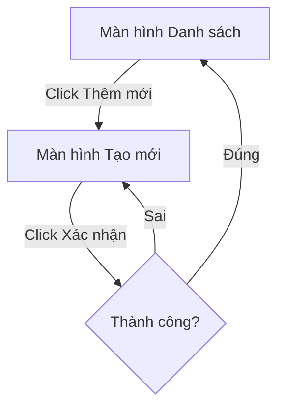

# [Tên Đặc tả Tính năng] (spec_template.md)

| Mục | Nội dung |
| :--- | :--- |
| **Phiên bản** | 1.0.0 |
| **Ngày cập nhật** | [YYYY-MM-DD] |
| **Tác giả** | [Tên tác giả] |
| **Trạng thái** | Draft / Reviewing / Approved |

---

## Mục lục

- [1. Mục đích & Bối cảnh](#1-muc-dich--boi-canh)
- [2. Yêu cầu Nghiệp vụ](#2-yeu-cau-nghiep-vu)
- [3. Đặc tả Giao diện & Luồng trải nghiệm (UI/UX)](#3-dac-ta-giao-dien--luong-trai-nghiem-uiux)
- [4. Thay đổi Cơ sở Dữ liệu & Cấu trúc dữ liệu](#4-thay-doi-co-so-du-lieu--cau-truc-du-lieu)
- [5. Định nghĩa API liên quan](#5-dinh-nghia-api-lien-quan)
- [6. Tiêu chí Hoàn thành (DoD - Definition of Done)](#6-tieu-chi-hoan-thanh-dod---definition-of-done)
- [7. Lịch sử thay đổi](#7-lich-su-thay-doi)

---

## 1. Mục đích & Bối cảnh
*[Mô tả ngắn gọn về tính năng này giải quyết vấn đề gì, tại sao cần làm và đối tượng sử dụng là ai.]*

---

## 2. Yêu cầu Nghiệp vụ
*[Liệt kê các quy tắc nghiệp vụ, các ràng buộc và các trường hợp sử dụng (use cases) của tính năng.]*

*   **Yêu cầu 1**: [Mô tả chi tiết yêu cầu 1]
*   **Yêu cầu 2**: [Mô tả chi tiết yêu cầu 2]

---

## 3. Đặc tả Giao diện & Luồng trải nghiệm (UI/UX)
*[Mô tả cấu trúc màn hình, hành vi của người dùng và các tương tác logic.]*

*   **Sơ đồ màn hình / Luồng chuyển trang**:

---

## 4. Thay đổi Cơ sở Dữ liệu & Cấu trúc dữ liệu
*[Mô tả các bảng mới, các cột thay đổi hoặc cấu trúc lưu trữ cần thiết cho tính năng.]*

*   **Bảng mới/Cột mới**:
    *   Tên bảng: `[tên_bảng]`
    *   Các cột quan trọng: `[tên_cột]` (`[kiểu_dữ_liệu]`) - `[mô tả]`

---

## 5. Định nghĩa API liên quan
*[Liệt kê hoặc dẫn link đến các tài liệu chi tiết của API REST/Realtime phục vụ cho tính năng này.]*

*   `GET /api/v1/resource` -> [Chi tiết xem tại api_template.md]

---

## 6. Tiêu chí Hoàn thành (DoD - Definition of Done)
*[Định nghĩa rõ ràng các điều kiện cần đạt được để coi tính năng này đã hoàn thành.]*

- [ ] Toàn bộ API được kiểm thử tự động đạt 100% thành công.
- [ ] Giao diện đáp ứng đúng thiết kế UI/UX trên cả màn hình Desktop và Mobile.
- [ ] Dữ liệu lưu xuống DB chính xác và có log ghi nhận thay đổi.

---

## 7. Lịch sử thay đổi

| No. | Phiên bản | Ngày thay đổi | Nội dung thay đổi |
| :--- | :--- | :--- | :--- |
| 1 | 1.0.0 | [YYYY-MM-DD] | Khởi tạo tài liệu đặc tả tính năng. |
